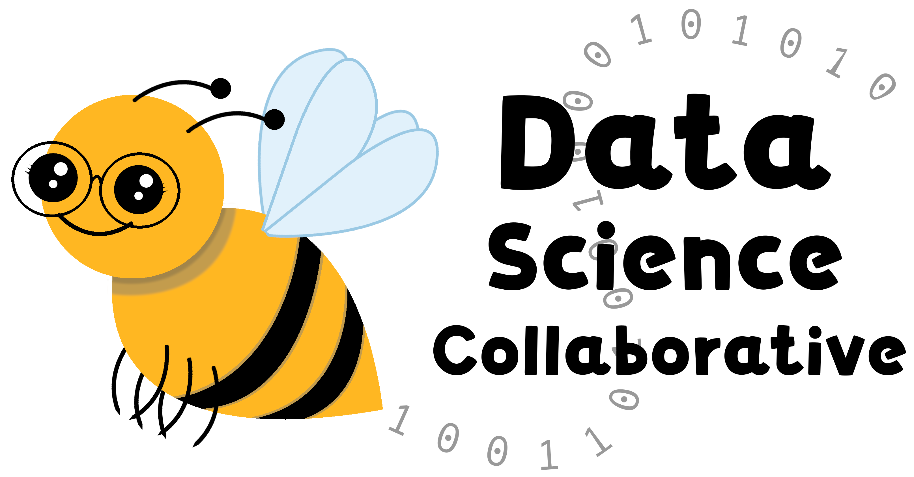

```{r, fig.align='center', fig.alt= "Example image", echo = FALSE, out.width="50%"}

```

### **About**

The Data Science Collaborative brings together experts in biomedical data science training and education across institutions. We jointly run a variety of training, education, software and tooling initiatives funded through federal agencies, non-profit institutions, and philanthropic organizations. Our programs support data science education in a number of scientific areas that are broadly applicable across the world. Our goal is to make data science education available to anyone who wants it. 

:::: {.project-callout}


::: {.project-copy}
### Explore our work

See what we’ve been building and browse our latest projects.
:::

[Our projects](projects.qmd){.project-button}

::::

<br>

:::: {.project-callout}


::: {.project-copy}
### Get to know us

Meet the team behind the Data Science Collaborative.
:::

[Our team](team.qmd){.project-button}

::::

<!-- This website was created with the [OTTR_Quarto website template](https://github.com/ottrproject/OTTR_Quarto). -->
